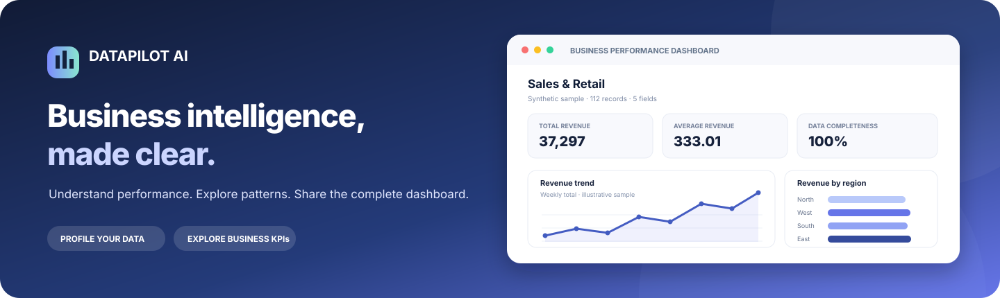
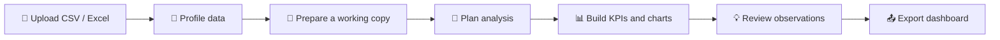
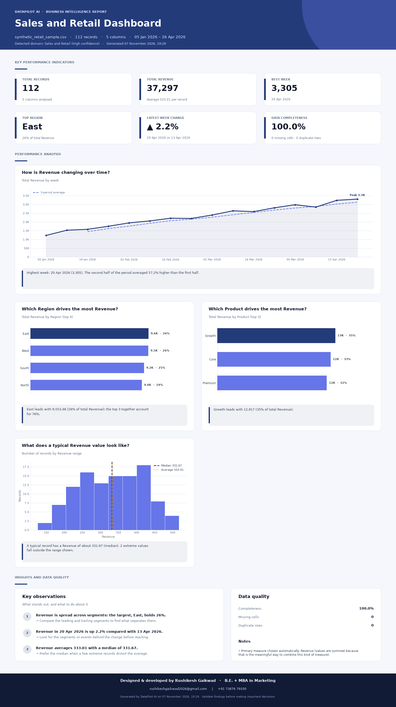
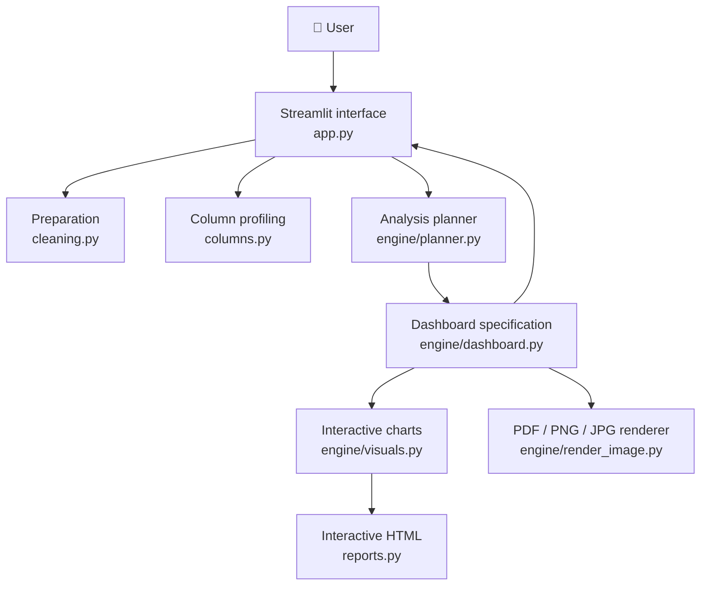

<div align="center">



### Your Autonomous AI Business Analyst

**Turn raw business data into a clearer view of performance — automatically.**

Upload a CSV or Excel workbook to explore its quality, discover useful measures,
compare business segments, and export a complete dashboard.

<p>
  <a href="https://github.com/rushikeshgaikwad2026-glitch/DataPilotAI/actions/workflows/tests.yml"></a>
  
  
  
  
</p>

[Launch locally](#-get-started) ·
[Explore features](#-what-you-can-do) ·
[Meet the author](#-author)

</div>

---

## 📌 Contents

- [Overview](#-overview)
- [The challenge](#-the-challenge)
- [What you can do](#-what-you-can-do)
- [How it works](#-how-it-works)
- [Dashboard preview](#-dashboard-preview)
- [Architecture](#architecture)
- [Technology](#technology)
- [Get started](#-get-started)
- [Project structure](#-project-structure)
- [Testing](#-testing)
- [Data and privacy](#-data-and-privacy)
- [Roadmap](#-roadmap)
- [Author](#-author)

## 💡 Overview

Business data is useful only when people can understand what it says. But
profiling a spreadsheet, choosing meaningful measures, building charts, and
preparing a shareable report can take time and specialist tools.

**DataPilot AI brings those steps into one Streamlit workspace.** It uses
statistical analysis and transparent, column-name heuristics to propose a
business domain, identify candidate measures and segments, calculate useful
summaries, and build charts when the available data supports them.

> **The goal:** make a first, understandable business analysis easier to reach.

## 🎯 The challenge

| Typical manual step | DataPilot AI |
|---|---|
| Inspect files to understand their shape | Summarizes records, columns, types, and data quality |
| Decide how to handle missing values | Offers configurable preparation with a before-and-after review |
| Guess which fields are meaningful measures | Recommends candidate measures while excluding likely identifiers |
| Build charts one by one | Creates trend, segment, distribution, and relationship views when supported |
| Assemble a shareable dashboard | Exports the complete dashboard as PDF, PNG, JPG, or interactive HTML |

Recommendations are intended to help exploration, not replace domain expertise.
Business-domain labels are heuristic, and observed relationships do not prove
causation.

## ✨ What you can do

### 📂 Understand a dataset

- Upload **CSV** and **Excel `.xlsx`** files.
- Review record counts, columns, missing cells, and duplicate rows.
- Explore column types, roles, uniqueness, completeness, and sample values.
- Preview the source data before making changes.

### 🧹 Prepare a working copy

- Choose how to handle missing numeric and categorical values.
- Optionally remove duplicate rows and trim text values.
- Compare data-quality measures before and after preparation.
- Keep the uploaded source unchanged; cleaning is applied to a separate copy.

### 📊 Explore business performance

- Review a suggested business domain and candidate fields.
- Choose a performance measure and a comparison segment.
- See performance indicators, data-quality context, and key observations.
- Explore charts only where the data meets basic suitability checks:
  time trends, segment comparisons, distributions, and numeric relationships.
- Read notes explaining metric aggregation and analysis limitations.

### 🧠 Review business insights

- Explore statistical findings and suggested follow-up actions.
- Review domain cues and analyses suggested for the dataset.
- Treat findings as decision support; validate them with business context.

### 📤 Share the dashboard

- Download the **complete dashboard as PDF**.
- Save dashboard images as **PNG** or **JPG**.
- Export an **interactive HTML dashboard**.
- Download cleaned data and its activity log as an **Excel workbook**.

## 🔄 How it works



## 🖼️ Dashboard preview

The preview below is generated from **synthetic sample data**. Upload your own
CSV or `.xlsx` file in the app to create a dashboard for your dataset.

<p align="center">
  
</p>

<a id="architecture"></a>
## 🏗️ Architecture

The app separates the Streamlit interface from the reusable dashboard planner,
analysis specification, visualizations, and image renderer. The same dashboard
specification feeds the on-screen experience and the full-page PDF and image
exports.



### Design principles

- Separate data analysis from the user interface.
- Reuse a single dashboard specification across views and exports.
- Preserve the uploaded source during data preparation.
- Exclude likely identifiers from business measures.
- Prefer a clear “not enough evidence” over a misleading chart.

<a id="technology"></a>
## 🛠️ Technology

| Technology | Purpose |
|---|---|
| Python | Application and analysis logic |
| Streamlit | Interactive web application |
| Pandas and NumPy | Data preparation and statistical analysis |
| Plotly | Interactive charts and HTML dashboard |
| Matplotlib and Pillow | Full-dashboard PDF and image rendering |
| OpenPyXL and XlsxWriter | Excel input and workbook exports |
| GitHub Actions | Automated regression tests |

## 🚀 Get started

### Requirements

- Python **3.10 or later**
- Git
- A CSV file or Excel `.xlsx` workbook to analyze

### 1. Clone the repository

```bash
git clone https://github.com/rushikeshgaikwad2026-glitch/DataPilotAI.git
cd DataPilotAI
```

### 2. Create and activate a virtual environment

**Windows PowerShell**

```powershell
py -m venv .venv
.\.venv\Scripts\Activate.ps1
```

**macOS / Linux**

```bash
python3 -m venv .venv
source .venv/bin/activate
```

### 3. Install dependencies and run

```bash
python -m pip install -r requirements.txt
python -m streamlit run app.py
```

Open the local address printed in the terminal (usually
[`http://localhost:8501`](http://localhost:8501)), upload a CSV or `.xlsx`
workbook, and choose a section from the sidebar.

> Legacy Excel `.xls` files are not currently supported.

## 🧩 Project structure

```text
DataPilotAI/
├── .github/workflows/tests.yml   # CI regression tests
├── .streamlit/config.toml        # Streamlit appearance and upload settings
├── docs/images/                  # README banner and sample dashboard
├── engine/
│   ├── dashboard.py              # Shared dashboard specification
│   ├── planner.py                # Measure, segment, KPI, and insight selection
│   ├── render_image.py           # Full-dashboard PDF and image renderer
│   └── visuals.py                # Interactive charts from the dashboard spec
├── tests/
│   ├── test_dashboard_exports.py
│   └── test_planner.py
├── app.py                        # Streamlit interface and navigation
├── business_analyst.py           # Domain cues and analysis suggestions
├── charts.py                     # Supporting Plotly chart builders
├── cleaning.py                   # Data cleaning operations
├── columns.py                    # Column profiling and type helpers
├── insights.py                   # KPI catalogue and statistical findings
├── project_info.py               # Product and author credits
├── reports.py                    # Interactive HTML and Excel exports
├── requirements.txt
└── theme.py                      # Application visual system
```

## 🧪 Testing

Run the regression tests locally:

```bash
python -m unittest discover tests -v
```

GitHub Actions runs the same test suite on pushes and pull requests. Tests
cover dashboard exports and chart construction as well as retail and HR data,
small and identifier-heavy datasets, missing and infinite values, constant
dates, and source-data immutability.

## 🔐 Data and privacy

DataPilot AI analyzes the file supplied to the running app. When running
locally, uploaded files are processed by your local application. If you deploy
or use a hosted instance, review its hosting, retention, access, and privacy
settings before uploading confidential or personal data.

Local environments, credentials, data folders, generated exports, and archived
copies are excluded from Git by default. **Do not commit secrets or sensitive
datasets.**

## 🔮 Roadmap

Possible future directions:

- A polished standalone website and deployment guide
- Optional conversational exploration of uploaded datasets
- Forecasting and anomaly-detection workflows
- More configurable analysis and business-domain rules
- Additional data connectors and multi-dataset analysis

These are ideas for future development, not features currently advertised as
available.

## 👨‍💻 Author

**Rushikesh Sunil Gaikwad**<br>
B.E. + MBA in Marketing · Business Intelligence · Data Analytics · Business Analysis

DataPilot AI is an independent portfolio project exploring how data analytics
and automation can make business analysis easier to approach.

| Connect | |
|---|---|
| Email | [rushikeshgaikwad2026@gmail.com](mailto:rushikeshgaikwad2026@gmail.com) |
| Mobile | [+91 73876 79330](tel:+917387679330) |
| LinkedIn | [Rushikesh Gaikwad](https://www.linkedin.com/in/rushikesh-s-gaikwad) |
| Portfolio | [Executive Portfolio](https://rushikesh-gaikwad-executive-presence-332392968552.asia-southeast1.run.app/) |
| GitHub | [rushikeshgaikwad2026-glitch](https://github.com/rushikeshgaikwad2026-glitch) |

---

<div align="center">

**DataPilot AI · Turning data into decisions.**

If you find this project useful, consider giving the repository a ⭐.

</div>
